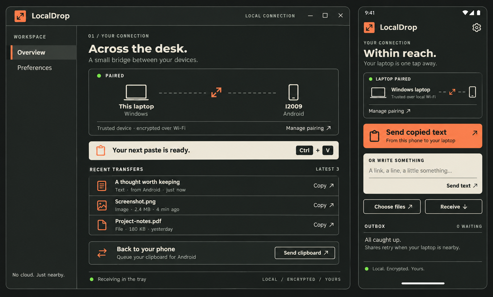

<div align="center">
  
  <h1>LocalDrop</h1>
  <p><strong>Share on Android. Paste on Windows.</strong></p>
  <p>A small, local clipboard bridge built with Rust, Kotlin and Tauri 2.</p>
  <p><a href="https://github.com/gurugsv7/localdrop/releases/tag/v0.3.0">Download the preview</a> · <a href="docs/BUILDING.md">Build it yourself</a> · <a href="CONTRIBUTING.md">Contribute</a></p>
  <p><a href="https://github.com/gurugsv7/localdrop/actions/workflows/ci.yml"></a> <a href="LICENSE"></a></p>
</div>

Pair your phone and laptop once with a QR code. Then use Android’s native
**Share → LocalDrop** and press **Ctrl+V** on Windows. Text becomes real clipboard
text; a supported single image becomes actual clipboard pixels; files and multiple
images arrive as original file references.

Transfers stay on your local network. No cloud, accounts, analytics or relay.



*The image above is the original design reference, generated with ChatGPT image
generation. Both interfaces are implemented in the app; actual content, native
fonts and responsive spacing vary. [Design notes →](design/DESIGN.md)*

## Get started

**Development preview · v0.3.0**

Windows 10/11 x64 · Android 8+ ARM64 · same trusted local Wi-Fi

1. Download [Windows](https://github.com/gurugsv7/localdrop/releases/download/v0.3.0/LocalDrop-Windows.zip)
   and the [Android APK](https://github.com/gurugsv7/localdrop/releases/download/v0.3.0/LocalDrop-android-arm64-debug.apk).
   Checksums are included with the [release](https://github.com/gurugsv7/localdrop/releases/tag/v0.3.0).
2. Extract the Windows ZIP into a permanent folder and run **LocalDrop.exe**.
   Keep its DLLs beside it. The UI needs Microsoft Edge WebView2 Runtime.
   LocalDrop enables per-user Windows startup and receives from the tray.
3. Install the APK on your phone. On Windows, choose **Pair a phone**.
   On Android, open **Preferences → Pairing → Scan laptop QR**.
4. Allow LocalDrop through Windows Firewall on **Private** networks only.
   Camera permission is used for QR scanning; Android notifications are optional.
5. Share text, a link, an image or a file to **LocalDrop** from an Android app.
   Paste on Windows with **Ctrl+V**. The main Android screen does not need to be open.

Keep the pairing QR private—it authorizes access to your clipboard bridge.
Already-paired devices keep their saved pairing during normal in-place updates.

The Windows executable is unsigned and the APK is development-signed. This is an
early preview, not an audited security product or a store release.

## What can I send?

| Android share | Windows clipboard | Notes |
| --- | --- | --- |
| Text and links | Actual Unicode text | Paste into text fields |
| One supported image | Actual bitmap + original file reference | PNG, JPEG, WebP and BMP, within decoder limits |
| Multiple images | All original file references | Destination must support multi-file paste |
| Videos and other files | Original file references | Destination decides which attachments it accepts |

For apps accepting one image per attachment paste, choose **Copy next image**,
paste, and repeat. LocalDrop never injects keystrokes into another app.

GIF, HEIC, AVIF, corrupt images and images above the bitmap limit are retained as
original files; automatic bitmap conversion is limited. Clipboard formats do not
guarantee that every destination app will accept every attachment.

## A few useful shortcuts

- **Selected text:** select text in an Android editor → **LocalDrop**, sometimes
  under **⋮**. Android and the host app control menu order.
- **Already copied text:** open Android LocalDrop → **Send copied text**.
  Clipboard access happens only after a user action while the app is foreground.
- **Write a quick note:** use the Android text composer and tap **Send text**.
- **Windows → Android:** click **Send clipboard** on Windows, then **Receive**
  on Android. Received files are available in Android Preferences.
- **Quick Settings:** the LocalDrop tile opens the document picker.
- **Shake:** optional, adjustable, and active only while LocalDrop is open.

## Built to stay small

The shared core handles networking, discovery, cryptography and streamed files.
Kotlin supplies Android OS integration. Tauri 2 hosts a small local settings UI
on Windows; the receiver, tray and desktop confirmations are native Rust/Win32.

- No Electron, frontend framework, Node runtime or database.
- No permanent Android service, background clipboard watcher or Accessibility access.
- No webview at Windows tray idle after the app window is closed.
- Bounded file chunks and asynchronous I/O.
- Durable Android outbox with OS-scheduled retries.
- Generic, non-focusing desktop confirmations that disappear after five seconds.

These are implementation choices, not a promise of zero memory use. Broader
idle CPU, RAM and battery benchmarks are still needed.

## Storage, trust and limits

Only the **latest three transfers** appear in the overview. Cached originals and
receipts remain on disk until you explicitly remove them. The default Windows
quota is 1 GiB per direction; Android’s outbox also has a 1 GiB limit. Full caches
pause transfers. See [storage details](docs/ARCHITECTURE.md#resource-and-storage-policy)
before removing files still referenced by the clipboard.

Sessions use Noise NNpsk0 with X25519, ChaCha20-Poly1305 and SHA-256. Windows
protects the pairing configuration with DPAPI; transfer payloads are **not
encrypted at rest**. Discovery identifiers are visible on the LAN.

Current boundaries:

- One trusted laptop/phone relationship.
- Reverse receive is user-initiated on Android.
- Shake is foreground-only; there is no global clipboard synchronization.
- Interrupted transfers restart from the beginning.
- Android can defer retries under Doze, force-stop or vendor battery policies.
- Guest Wi-Fi isolation, VPN routes and firewall rules can prevent discovery.
- Production signing, automatic updates and a security audit remain future work.

Read the [security model](SECURITY.md) and [observed validation](VALIDATION.md).

## Build and contribute

```sh
git clone https://github.com/gurugsv7/localdrop.git
cd localdrop
cargo test --locked -p localdrop-core -p localdrop-android -j 2
```

Windows build: Rust stable, C++ Build Tools/Windows SDK and WebView2.
Android build: JDK 17, SDK 35, NDK r27+ and the checked-in Gradle wrapper.

```powershell
./scripts/build-windows.ps1
./scripts/build-android.ps1
```

The scripts stage packages under `dist/`. Set Android SDK/NDK paths first.
See the [complete build guide](docs/BUILDING.md) for toolchains and clipboard checks.

| Read next | |
| --- | --- |
| [Architecture](docs/ARCHITECTURE.md) | Protocol, platform boundaries and resource policy |
| [Contributing](CONTRIBUTING.md) | Scope, tests and pull requests |
| [Security](SECURITY.md) | Trust, revocation and vulnerability reports |
| [Validation](VALIDATION.md) | What was actually tested and what remains |
| [Changelog](CHANGELOG.md) | Current preview |

## License

[MIT](LICENSE) © 2026 Gurusabarivasan. Dependencies retain their own
[licenses and notices](THIRD_PARTY_NOTICES.md).
